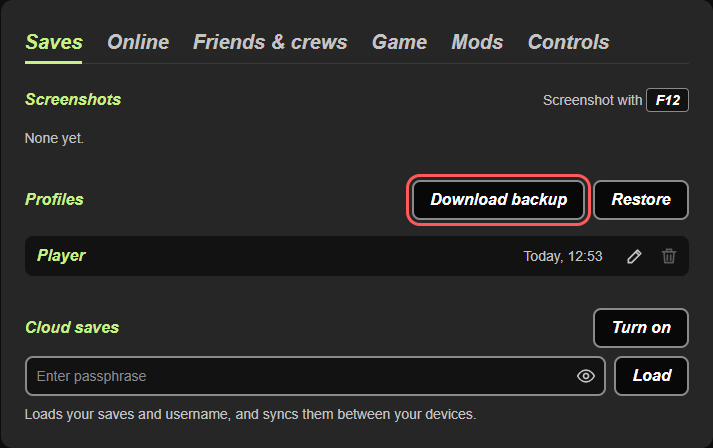
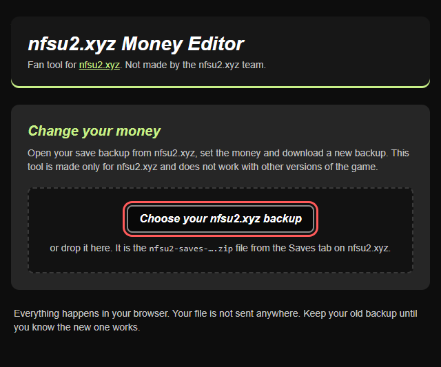
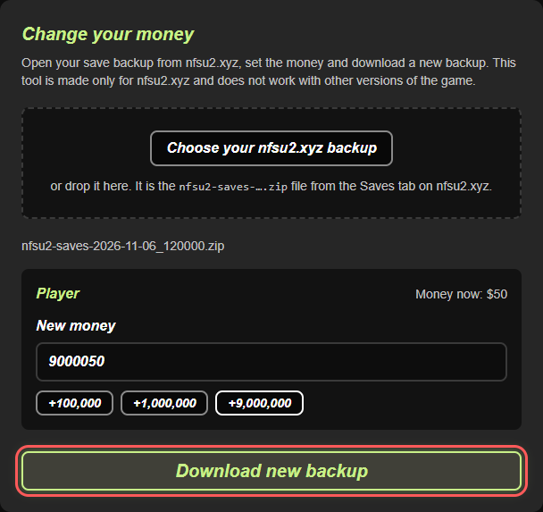
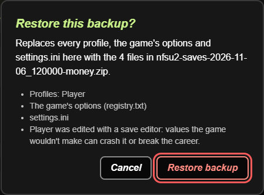
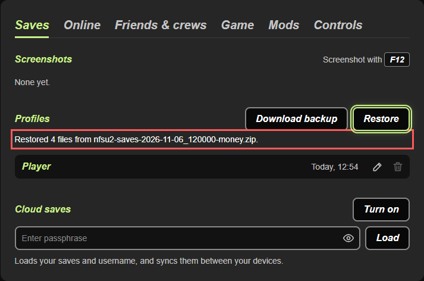

# nfsu2.xyz Money Editor

A small tool to change the money in your [nfsu2.xyz](https://nfsu2.xyz) save. nfsu2.xyz lets you play Need for Speed: Underground 2 in the browser. This tool opens the backup file you download from nfsu2.xyz, changes the money, and gives you a new backup to restore on nfsu2.xyz.

The tool is made only for nfsu2.xyz. It does not work with the original PC game or with console versions. It is a fan tool and is not made by the nfsu2.xyz team.

The tool runs in your browser. You do not need to install anything, and your file is not sent anywhere.

**Open the tool: [nfsu2-money-editor.vercel.app](https://nfsu2-money-editor.vercel.app)**

## How to use it

### 1. Save your game and close it

Your backup only has what the game saved. In the game, press `Esc` (or `Start` on a controller) and go to **Garage > Save**.

Then close the game to get back to the nfsu2.xyz page. The page tells you the time of your last save, so you can check that it worked.

### 2. Download a backup

On nfsu2.xyz, open the **Saves** tab. Under **Profiles**, click **Download backup**.



You get a file called something like `nfsu2-saves-2026-11-06_115219.zip`. Keep this file. It is your copy of the old save, so you can go back to it if something goes wrong.

You do not need to unzip it.

### 3. Open the tool

Open [nfsu2-money-editor.vercel.app](https://nfsu2-money-editor.vercel.app) in Chrome or Firefox. The page also has these steps under **How to use it**, so you can follow them there.

You can also use the tool without internet:

1. At the top of this page on GitHub, click the green **Code** button and then **Download ZIP**.
2. Unzip the file you downloaded.
3. Open the unzipped folder and double-click `index.html`.

Keep `index.html` together with the `src` and `docs` folders. The tool does not work if you move `index.html` out of the folder alone.

### 4. Change the money

Click **Choose your nfsu2.xyz backup** and pick the zip file from step 2. You can also drag the file onto the box.



The tool shows each profile in the backup and how much money it has now. Type the new amount in **New money**, or click one of the buttons to add 100,000, 1,000,000 or 9,000,000. Then click **Download new backup**.



The browser saves a new file with `-money` at the end of the name, for example `nfsu2-saves-2026-11-06_115219-money.zip`. It is usually in your Downloads folder.

### 5. Restore the new backup

Go back to nfsu2.xyz and open the **Saves** tab. Under **Profiles**, click **Restore** and choose the new `-money.zip` file.

nfsu2.xyz asks you to confirm. Click **Restore backup**.



The window says that your profile "was edited with a save editor". You see this message for every backup this tool changes, so it does not mean something went wrong. nfsu2.xyz shows it because changed values can crash the game or break the career. Keep the money at a sensible amount, and keep your old backup.

Restore replaces every profile on nfsu2.xyz with the profiles in the backup. Your new backup has all the profiles from step 2, so you do not lose any. Only the money is different.

When the restore is done, you see a message like `Restored 4 files from nfsu2-saves-...-money.zip`.



### 6. Play

Press **Play** and load your profile. You should see the new money.

## If you use cloud saves

With cloud saves turned on, nfsu2.xyz syncs your saves between your devices. After you restore the new backup, click **Sync now** so the cloud gets the new money. If nfsu2.xyz asks which saves to keep, choose **Keep this browser's**. If you choose **Use the cloud's**, you get the old money back.

## Limits

You can set any whole number from 0 to 2,147,483,647.

The tool only works with backups from the **Saves** tab on nfsu2.xyz.

## If something goes wrong

If the game on nfsu2.xyz crashes or does not load your profile, open the **Saves** tab, click **Restore**, and choose your old backup from step 2.

## How it works

A backup from nfsu2.xyz is a zip file. Each profile is in it as `NFS Underground 2/<profile>/<profile>`. In that file, the money is a 4-byte number at offset `0xA16A`.

The tool finds every profile in the zip, changes those 4 bytes, and updates the zip checksum for that file. It does not change anything else, so the new zip is the same size as the old one.

## For developers

The page is `index.html`. The code is in `src/`: `backup.js` reads and changes the backup, `app.js` runs the page, and `styles.css` has the styles. The README screenshots are in `docs/screenshots/`. There are no dependencies.

Run the tests with Node.js 20 or newer:

```
npm test
```

## Contributing

Bug reports, ideas and pull requests are welcome. Read [CONTRIBUTING.md](CONTRIBUTING.md) first. Please follow the [code of conduct](CODE_OF_CONDUCT.md). To report a security problem, see [SECURITY.md](SECURITY.md).

## License

[MIT](LICENSE)
